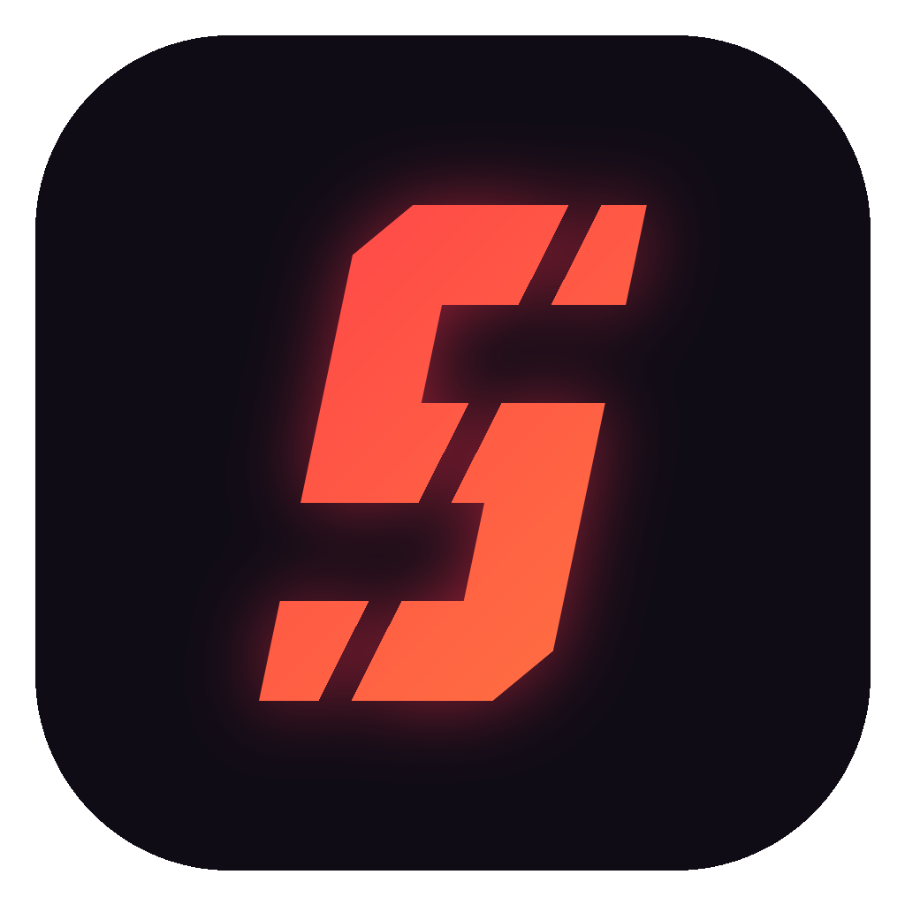

<p align="center"></p>

<h1 align="center">Slayer Kit</h1>
<p align="center"><b>Le kit stream complet pour les streamers RP FiveM.</b><br>
OBS configuré en un clic, overlays, alertes, télécommande et sauvegardes, par yns_bnl.</p>

<p align="center">
  <a href="https://github.com/ybyns2/slayer-kit/releases/latest"></a>
  <a href="https://github.com/ybyns2/slayer-kit/actions/workflows/ci.yml"></a>
  <a href="LICENSE"></a>
  
</p>

---

## Télécharger

Dernière version : **[Releases](https://github.com/ybyns2/slayer-kit/releases/latest)**, fichier `SlayerKit-Setup-X.Y.Z.exe`.

Chaque installateur est compilé par GitHub Actions directement depuis ce code public, et son empreinte SHA-256 est publiée avec la release. Comme l'application n'est pas signée, Windows peut afficher « Windows a protégé votre ordinateur » : clique sur **Informations complémentaires**, puis **Exécuter quand même**.

## Ce que fait Slayer Kit

| | |
|---|---|
| Assistant | Plateformes, logiciel (OBS, TikTok LIVE Studio, Streamlabs), serveur, sauvegarde : tout en quelques clics |
| Serveurs | Packs Unity Legacy, FratWorld, Night FA ; détection automatique du serveur ouvert dans FiveM |
| Sauvegardes | Copie complète d'OBS, TikTok LIVE Studio, FiveM et GTA avant chaque changement, plus un repo GitHub **privé** sur ton compte |
| Mises à jour | Vérifiées à chaque lancement ; tes modifications sont gardées ; les mises à jour critiques attendent la fin du live |
| Audio | Choix du micro avec vumètre, test micro guidé en 3 temps, réglage automatique (gain, bruit, portillon, compresseur), redif Twitch sans musique |
| Musique | Détection Spotify / Deezer / Apple Music / sites web, installation automatique, 3 musiques d'écran personnalisables (par défaut : Kevin MacLeod, CC BY 4.0) |
| OBS | Collection complète par serveur en un clic : 7 scènes, captures séparées (micro, jeu, musique, Discord), décomptes automatiques, transitions, raccourcis Ctrl+Alt+N, encodeur GPU détecté |
| FiveM | Vérifie les réglages son (focus, radio GTA, vocal) et les corrige à la fermeture du jeu |
| Diffusion | Clés Twitch / YouTube / Kick / TikTok chiffrées sur le PC, guide par plateforme, installation d'Aitum Vertical (TikTok en parallèle) et de VB-CABLE (TikTok LIVE Studio) |
| Overlays | Chat unifié Twitch + Kick avec emotes (fenêtre détachable pour un 2e écran), alertes Twitch animées (follow, sub, bits, raid), musique en cours, carte personnage RP, éditeur de disposition à la souris |
| Extras | Annonce Discord « je suis en live » personnalisable (embed), clips Ctrl+Alt+C, mode performance, statistiques des lives |
| Télécommande | QR code à scanner : scènes, micro, lancer/couper le live, clips, depuis le téléphone (même Wi-Fi, lien privé) |

## Confidentialité

- Aucune statistique, aucune collecte.
- Tes clés de stream sont chiffrées par Windows (DPAPI) sur ton PC et ne sont jamais envoyées, même dans la sauvegarde GitHub privée.
- La sauvegarde GitHub se fait sur **ton** compte, dans un repo privé que tu contrôles.

## Compiler soi-même

Il faut Visual Studio 2022 Build Tools (C++), le SDK Windows et CMake (fourni avec les Build Tools).

```
build.cmd           version publique (demande les droits admin)
build-dev.cmd       version de développement (sans admin, données séparées)
```

Les détails sont dans [CONTRIBUTING.md](CONTRIBUTING.md).

## Contribuer

Slayer Kit est un projet communautaire : tout le monde peut proposer des améliorations, et chaque proposition est relue avant d'être publiée.

- **Un bug ?** [Signale-le](https://github.com/ybyns2/slayer-kit/issues/new?template=bug.yml), ou utilise le bouton « Signaler un problème » de l'application.
- **Une idée ?** [Propose-la](https://github.com/ybyns2/slayer-kit/issues/new?template=idee.yml).
- **Du code ?** Ouvre une pull request en suivant [CONTRIBUTING.md](CONTRIBUTING.md).
- **Ton serveur RP ?** Ajoute son pack sur [slayer-kit-packs](https://github.com/ybyns2/slayer-kit-packs), même sans savoir utiliser Git.

Merci de respecter le [code de conduite](CODE_OF_CONDUCT.md). Pour une faille de sécurité, voir [SECURITY.md](SECURITY.md).

## Crédits musique

Musiques par défaut : « Volatile Reaction », « Lobby Time », « Cool Vibes » — Kevin MacLeod (incompetech.com), licence Creative Commons Attribution 4.0.

## Licence

MIT © yns_bnl — voir [LICENSE](LICENSE).
